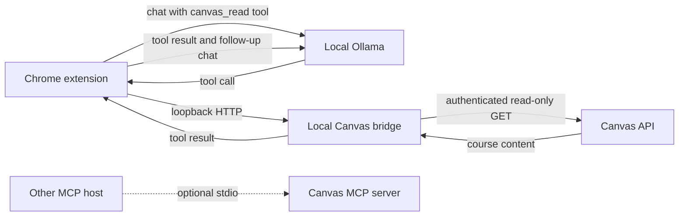

# Canvas MCP Server Design

**Status:** Pre-alpha MVP

## Purpose

Let the selected local Ollama model retrieve a student's relevant Canvas course information through a read-only local helper. The Node.js process also exposes the same Canvas operations over MCP stdio for compatible hosts.

## Scope

The MVP reads active courses, modules, pages, assignments, and Canvas-hosted course files that the authenticated user can access. File access includes assignment attachments, not arbitrary files on the user's computer or MCP host. It never submits or edits coursework.

## Architecture

Run the Canvas integration as a standalone Node.js process, separate from the Chrome extension. The process owns the Canvas API client and token. In bridge mode it listens only on `127.0.0.1:4317`, accepts requests only from the configured extension origin, and exposes a bounded read-only helper to the extension. The extension passes that helper as a tool to the selected local Ollama model, then sends tool results back to Ollama for its response. The process also retains MCP stdio mode for compatible MCP hosts; it is not bundled into the Vite extension.

The request path is:

Ollama inference stays on `localhost:11434`; no hosted model service is used. The Node.js process makes HTTPS requests to the configured Canvas instance, so Canvas must be reachable over the network. The browser extension never receives the Canvas token. Use an Ollama model that supports tool calling.

## Initial Tools

- `list_courses`: return the authenticated user's active courses, with Canvas course ID, name, and term when available.
- `list_course_materials`: return the modules, pages, files, and assignments available in a course, with IDs and titles so the model can request specific content.
- `list_assignments`: return compact assignment metadata for a course (title, due date, and points possible). Accept a course ID and an optional result limit.
- `get_assignment`: return one assignment's details and sanitized instructions for a specified course and assignment ID.
- `get_course_page`: return the sanitized text of a Canvas course page by its page URL slug.
- `list_course_files`: return files available in a course, including Canvas file ID, name, content type, and size. Do not expose raw download URLs to the model.
- `read_course_file`: retrieve an accessible file by Canvas file ID and return bounded text for plain-text and HTML files. Other types, including PDF, are reported as unsupported in this dependency-free pre-alpha.

For the extension, Ollama sees one function tool, `canvas_read`, with an `action` selecting one of the operations above. Tool arguments are validated by both the extension schema and local bridge. The chat wrapper executes at most four tool rounds and eight individual calls per user message, then returns results to Ollama for a final response. The bridge binds to loopback, checks the exact configured Chrome extension origin, accepts only `POST /tools/call` and preflight requests, and limits request bodies to 16 KB.

Tools are read-only, validate all inputs, and return concise structured content with source IDs. The Canvas client allows only `GET` requests to an explicit set of read endpoints and rejects all write methods; no tool can submit or modify coursework. Canvas pages, assignment instructions, and extracted file text are untrusted content: strip active markup, bound returned content, and never treat embedded instructions as system or developer instructions. File retrieval uses only the HTTPS URL returned by Canvas for the requested file; bearer credentials are attached only when that URL shares the configured Canvas origin, and tool callers cannot provide arbitrary file URLs.

## Authentication and Data Handling

The current pre-alpha uses a Canvas API token belonging to the signed-in Canvas user, loaded by Node from `src/.env`. OAuth is not implemented yet. Never embed credentials in source, logs, tool output, or the extension bundle. The browser extension does not receive the token. Do not persist retrieved course data or file contents unless a later requirement justifies caching.

The existing Google SSO in the extension is not a Canvas credential and must not be reused as one. Canvas OAuth and secure token renewal remain future work.

## Errors and Limits

Return actionable MCP errors for missing configuration, authentication/authorization failures, unavailable Canvas hosts, invalid IDs, unsupported file types, oversized files, extraction failures, and rate limits. Preserve Canvas status codes internally for diagnostics while excluding tokens and sensitive response bodies from logs. Use bounded pagination, file-size and extracted-text limits, and timeouts; respect Canvas rate-limit responses.

## Delivery Steps

1. Validate the tools against a Canvas test account, including expired credentials, access denial, pagination, rate limiting, unsupported files, and attempted write operations.
2. Add PDF extraction and broader file-format support if needed.
3. Design Canvas OAuth and token renewal before distributing the pre-alpha beyond local testing.

## Open Decisions

- Which Canvas instance(s) and deployment environments must be supported?
- When should Canvas OAuth and token renewal replace manually configured API tokens?
- Which MCP host will launch the first server, and where will its credentials be stored?
- What Canvas scopes, supported file formats, and assignment fields are required for the first release?

## Run Locally

Use a Canvas API token for the user whose courses should be available. Put `CANVAS_BASE_URL`, `CANVAS_API_TOKEN`, and `CHROME_EXTENSION_ID` in `src/.env`; the extension ID is shown at `chrome://extensions`. This file is ignored by Git. From `my-chrome-extension`, run `npm run dev:all` to start Vite and the loopback helper together. Load/reload the extension and select a tool-capable local Ollama model. The helper accepts only the configured extension origin and has no public network listener. To run only as an MCP stdio server, build with `npm run build:mcp` and launch `node --env-file=src/.env mcp-dist/index.js`. Node 20.6 or later supports `--env-file`.

## Viewing the Diagram

In VS Code, open this file's Markdown Preview with **Ctrl+Shift+V** (or **Ctrl+K V** to open it beside the editor) to render the Mermaid diagram.
