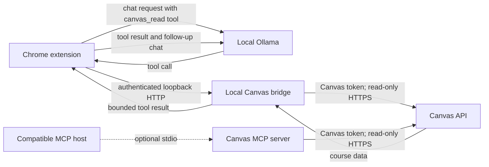

# Canvas Integration Design

**Status:** Pre-alpha MVP

## Summary

The Canvas integration gives a selected local Ollama model bounded, read-only access to course information available to the signed-in Canvas user. A standalone Node.js process owns Canvas credentials and serves the same operations through either a loopback HTTP bridge for the Chrome extension or MCP stdio for compatible hosts.

## Goals

- Read active courses, course materials, assignment details, course pages, and supported Canvas files.
- Keep Canvas credentials in the Node.js process; never expose them to the extension or model.
- Restrict access to validated read operations and return bounded, sanitized results.
- Support local extension use and MCP-compatible hosts without bundling the Canvas client into the extension.

## Non-Goals

- Submitting, editing, or otherwise changing coursework or Canvas data.
- Reading arbitrary files from the user's computer or MCP host.
- Hosted model inference, Canvas OAuth, or automatic credential renewal in this pre-alpha.
- PDF or other non-text file extraction.

## System Context

Ollama runs at `127.0.0.1:11434`; the bridge listens only at `127.0.0.1:4317`. Canvas must be reachable over HTTPS. The selected Ollama model must support tool calling. No hosted model service is involved.

## Components

| Component | Responsibility |
| --- | --- |
| Chrome extension | Presents the chat workflow, exposes `canvas_read` to Ollama, executes validated tool calls, and returns tool results to the model. |
| Local bridge | Authenticates loopback callers, validates Canvas tool input, proxies a fixed set of Ollama routes, and returns bounded responses. |
| `CanvasClient` | Owns the Canvas token, constructs allow-listed API requests, normalizes responses, and applies rate, cache, pagination, and file-read limits. |
| MCP server | Registers the same read-only Canvas operations for MCP stdio hosts. |
| Canvas API | Source of the user's accessible courses and course content. |
| Local Ollama | Performs inference and requests Canvas operations through tool calls. |

The Node.js process is separate from the Vite extension bundle. Bridge mode and MCP stdio mode share the Canvas client and its operation set.

## Request Flow

1. The extension sends the conversation and the `canvas_read` function definition to Ollama.
2. If Ollama requests a Canvas operation, the extension posts the action and arguments to `POST /tools/call` on the loopback bridge.
3. The bridge validates the action and arguments, then calls the corresponding `CanvasClient` method.
4. The client makes allow-listed HTTPS `GET` requests to Canvas and returns normalized, bounded data.
5. The bridge returns the tool result to the extension, which sends it to Ollama for a follow-up response.

The chat wrapper permits at most four tool rounds and eight individual tool calls per user message.

## Interfaces

### Canvas Operations

The extension presents one Ollama function, `canvas_read`, with an `action` selecting an operation. Both the extension and bridge validate arguments.

| Action | Result |
| --- | --- |
| `list_courses` | Active courses with IDs, names, and term when available. |
| `list_course_materials` | Course modules, pages, files, and assignment summaries. |
| `list_assignments` | Assignment IDs, names, due dates, and points possible; limit 1-50, default 25. |
| `get_assignment` | Assignment summary, sanitized instructions, and attachment metadata. |
| `get_course_page` | Sanitized text for a page selected by its URL slug. |
| `list_course_files` | File ID, name, content type, and size; download URLs are omitted. |
| `read_course_file` | Bounded plain-text or HTML content for a Canvas file ID. |

The MCP stdio server registers these operations individually. Neither interface accepts arbitrary Canvas URLs or write operations.

### Local HTTP Bridge

The bridge exposes only the following routes:

| Route | Method | Purpose |
| --- | --- | --- |
| `/tools/call` | `POST` | Execute a validated Canvas read action. |
| `/ollama/api/tags` | `GET` | List locally available Ollama models. |
| `/ollama/api/chat` | `POST` | Send a chat or tool-call request to Ollama. |
| `/ollama/api/generate` | `POST` | Generate a completion through Ollama. |
| `/ollama/api/embeddings` | `POST` | Generate embeddings through Ollama. |
| `/ollama/api/show` | `POST` | Read Ollama model metadata. |

The Ollama proxy uses a fixed route map to `127.0.0.1:11434`; callers cannot choose an upstream host or path. Canvas tool request bodies are limited to 16 KiB. Ollama request and response bodies are limited to 2 MiB, with a 180-second upstream timeout.

## Security and Privacy

- The bridge binds to loopback only; it is not a public network service.
- If a request includes `Origin`, it must exactly match the configured extension origin or, in development, the configured loopback Vite origin. A matching extension ID header does not override a disallowed `Origin`.
- When `Origin` is absent, the bridge accepts an extension request only when `X-Chrome-Extension-Id` matches the configured extension ID. CORS is never wildcarded; preflight allows only `Content-Type` and `X-Chrome-Extension-Id`.
- `CANVAS_API_TOKEN` is loaded by Node from `src/.env`. Do not put credentials in source, logs, tool output, or the extension bundle. The extension's Google SSO credential is not a Canvas credential.
- Canvas client methods are read-only. File download URLs come from Canvas for a requested file ID, must use HTTPS, and are validated; bearer credentials are sent only to the configured Canvas origin.
- Course pages, assignment instructions, and file contents are untrusted data. Strip active markup, bound returned text, and do not interpret embedded instructions as system or developer instructions.
- Retrieved course data and file contents are not persisted. The in-memory response cache is short-lived and limited in size.

## Limits and Failure Behavior

| Area | Constraint |
| --- | --- |
| Canvas requests | 15-second timeout; requests are serialized with a minimum 500 ms interval. |
| Pagination | At most five pages per list operation; pagination links must remain on the configured Canvas origin and API path. |
| Canvas cache | Successful JSON reads are cached for 30 seconds, up to 100 entries; concurrent identical reads share an in-flight request. |
| Canvas rate limits | On HTTP 429, honor `Retry-After` up to 30 seconds and retry once; other failures are not retried. |
| File reads | Maximum 2 MiB source file and 20,000 returned text characters. Plain text and HTML/XHTML are supported; other content types are rejected. |
| Ollama proxy | Fixed local upstream, 2 MiB request/response limit, and 180-second timeout. |

Failures should identify actionable conditions such as missing configuration, Canvas authorization errors, unavailable hosts, invalid IDs, rate limits, unsupported file types, oversized content, and extraction failures. Preserve upstream status codes for diagnostics, but do not log credentials or sensitive response bodies.

## Configuration and Operation

Set `CANVAS_BASE_URL` and `CANVAS_API_TOKEN` in the ignored `src/.env` file. `CANVAS_BASE_URL` must be an HTTPS origin without a path or embedded credentials.

For development, run `npm run dev:all` from `my-chrome-extension`. The bridge uses `CHROME_EXTENSION_ID` when configured, otherwise it derives the ID from the public key in `manifest.json`. It also allows the exact `CANVAS_DEV_ORIGIN`, defaulting to `http://localhost:5173`. Set these to match the ID shown at `chrome://extensions` and the active Vite port. The helper remains loopback-only.

For a non-development extension bridge, set `CHROME_EXTENSION_ID`. To run the MCP stdio server, build with `npm run build:mcp` and launch `node --env-file=src/.env mcp-dist/index.js`. Node.js 20.6 or later is required for `--env-file`.

## Validation and Future Work

Before broader distribution, validate against a Canvas test account: expired credentials, denied access, pagination, rate limiting, unsupported and oversized files, and attempted write operations. Add PDF or other file-format extraction only if required. Design Canvas OAuth and token renewal before distributing beyond local testing.

## Open Decisions

- Which Canvas instances and deployment environments must be supported?
- When should OAuth and secure token renewal replace manually configured API tokens?
- Which MCP host will launch the first server, and where will its credentials be stored?
- Which Canvas scopes, file formats, and assignment fields are required for the first release?
